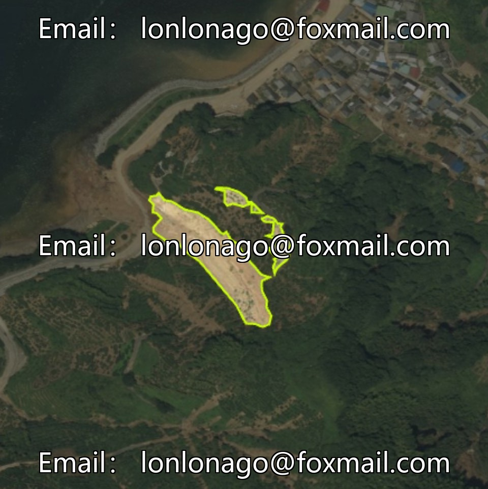
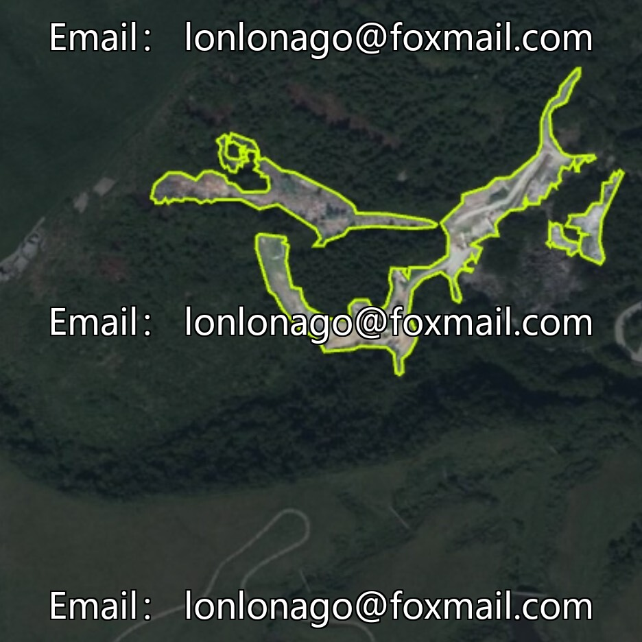
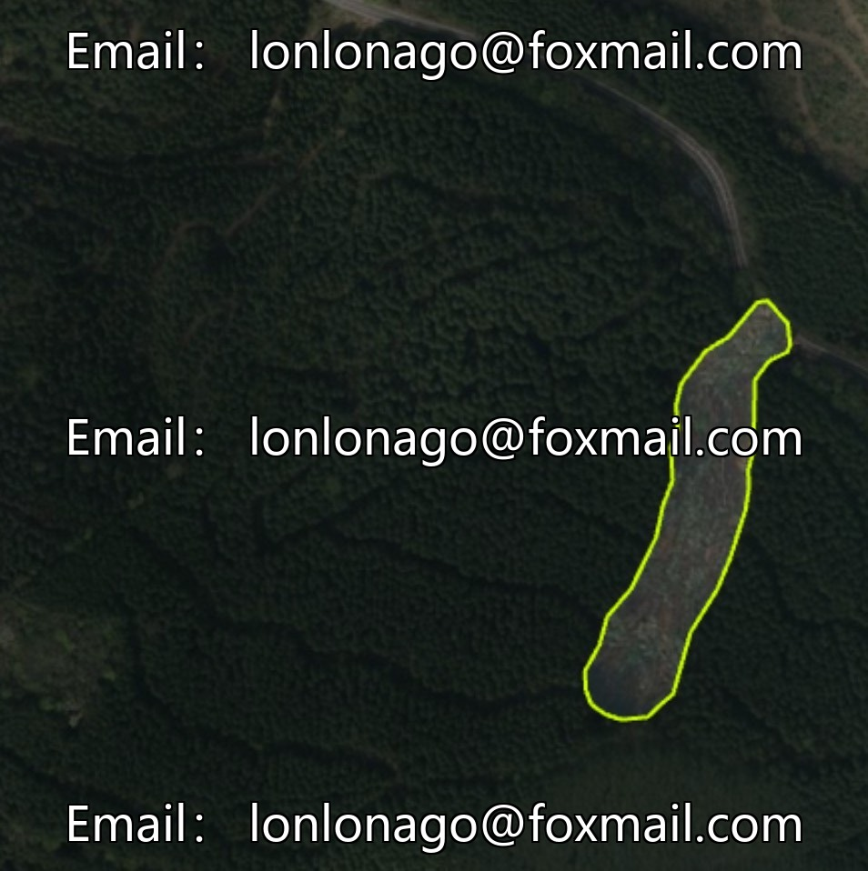
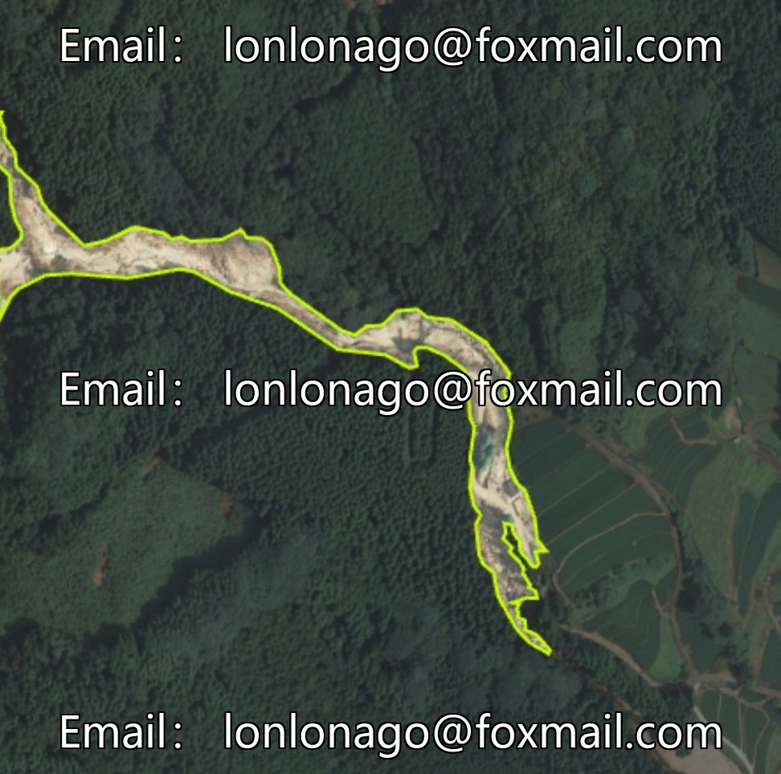
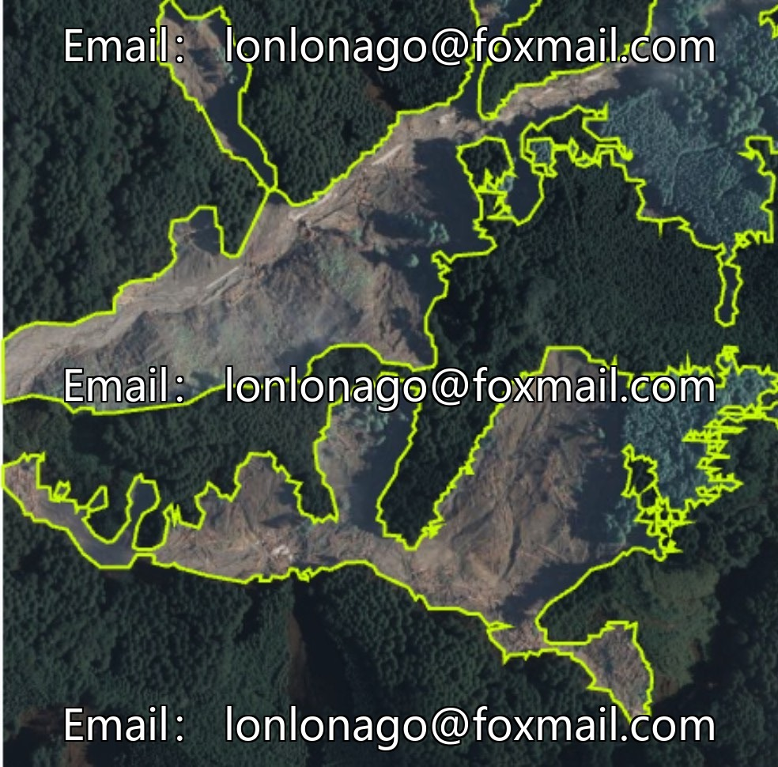

# Natural disaster landslide identification dataset, geological disaster example segmentation model, mudslide and landslide recognition

## Body

Natural Disaster Landslide Identification Dataset, Geological Hazard Example Segmtion Model, Mudslide and Landslide Identification, Disaster Monitoring and Early Warning Algorithm Development, Satellite Image Disaster Analysis, YOLO+VOC Format Dataset Issue 10609

The dataset consists of 2400 images, divided into two categories: mudslides and landslides. It supports instance segmentation annotations, suitable for training models in geological disaster instance segmentation, mudslide and landslide identification, disaster monitoring and early warning algorithm development, and remote sensing image disaster analysis. The dataset focuses on geological disaster scenarios, covering real-world disaster scenes, is compatible with segmentation-based deep learning frameworks, and can be directly used for model training, validation, and testing.

Virtual materials, once sold, are non-refundable.
Interested friends, click "I want" to proceed.

## Images

## Payment

Here is a pay link on Stripe ( https://buy.stripe.com/3cs8yP7sY87d0vu9AB ). Please contact me lonlonago@foxmail.com after funding $89, and I will send you a complete data files , thank you!

